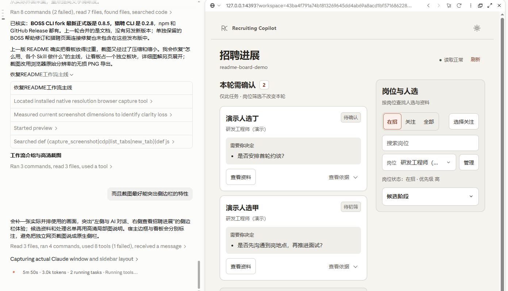

# recruiting-copilot · AI 招聘副驾

给 HR 和猎头用的一套 AI 招聘工作流。先逐岗梳理真实要求，再做 BOSS 直聘与猎聘双平台寻源、简历初筛和经授权的联系，最后补齐候选台账、档案与日报。收到外部简历、需要深度人才盘点或安排面试时，也有对应流程。

支持 Claude Code、Codex、WorkBuddy、Qoder、MiniMax Code、ZCode 等能读取项目文件的 AI 工具。招聘标准、候选台账和面试档案保存在你自己的工作区，换工具也能接着做。

当前正式版为 **v0.7.0**。[开始使用](#开始使用) · [完整 Skill 目录](#完整-skill-目录) · [已有工作区升级](docs/releases/v0.7.0.md#升级已有工作区)

## 从首次使用到日常招聘

### 第一次：建工作区，再逐岗梳理

按[开始使用](#开始使用)准备环境后，用 AI 工具打开本仓库，说：

> 帮我初始化招聘工作区。

`recruit-init` 会检查依赖，在你指定的独立目录创建模板、台账与各工具的 Skill 入口，然后逐个岗位进入 `recruit-grill`。已有工作区只补缺失项，不覆盖原有招聘数据。

岗位梳理一次只问一个问题，把“想招什么人”问成可以执行的标准。每个岗位产出对外 JD、对内寻源笔记、`CONTEXT.md` 中的硬规则与术语，以及首轮搜索词。硬门槛、命脉技能、排除信号和目标公司都要明确，未梳理的岗位先补标准，再做寻源。

### 每天：寻源初筛、按授权联系，补台账和出日报

以后用 AI 工具打开**你自己的招聘工作区**，说：

> 处理今天的招聘。

`recruit-daily` 每次先读最新的 `CONTEXT.md`、工作约定和各岗对内笔记，再按岗位优先级执行：

1. 查 BOSS 和猎聘的未读与未处理人选，按标准核对需要跟进的事项。
2. 在两个平台主动寻源。每个目标岗位都覆盖搜索和推荐入口；已有渠道无效结论时，注明原因后跳过。
3. 按硬门槛、命脉技能和排除信号初筛，记录匹配证据、风险与建议动作。
4. 核对联系授权和既有台账，再联系合适的人选。逐人回报结果，未核实发送成功时不记为已联系。
5. 更新 `02-sourcing/dedup-ledger.csv`，按姓名与应聘岗位去重。需要推进的人选补面试档案，日报列出按岗人选和待你确认的事项。
6. 从本轮命中的真实简历提取有效搜索词，回填各岗对内笔记的关键词迭代表，供下一轮使用。

打招呼默认等你确认。你可以在本轮明确说“合适的直接打招呼”，AI 在该轮授权范围内执行并逐一回报；下一轮或第二天不自动沿用授权。

### 新开岗位或修改标准

- 新开岗位时说“帮我梳理 XX 岗位”。先完成该岗的 `recruit-grill`，再加入每日招聘。
- 修改要求时说清岗位和变化，例如“XX 岗的地点要求改成深圳坐班”。AI 按已确认的需求更新 `CONTEXT.md` 和相关岗位资料，并在“已对齐决策”中记下带日期的变更。
- 寻源几轮后人选总不对，带着台账重梳硬门槛和命脉技能；对市场供给没把握时，先做一次人才盘点。

收到猎头、内推或直投简历时，用 `resume-review` 评估并并入同一套台账；人选进入面试时，用 `interview-schedule` 安排日程。完整入口见下方 Skill 目录。不确定下一步时，直接问“这套工具怎么用”。

## 开始使用

准备 Node.js ≥ 22、本机 Chrome 或 Edge，以及可正常登录的 BOSS 直聘或猎聘招聘者账号。涉及哪个平台，就完成对应平台的登录。Windows 下的 `sh` 命令在 Git Bash 中运行。

### 通用方式：所有能读取项目文件的 AI 工具

#### 1. 下载固定版本并安装依赖

```bash
git clone --branch v0.7.0 --depth 1 https://github.com/Viy1204/recruiting-copilot.git
```

进入源码目录。

```bash
cd recruiting-copilot
```

安装两个平台的 CLI。

```bash
sh skills/recruit-init/scripts/install-dependencies.sh
```

安装器默认使用 BOSS 维护包 `@viyzhu/boss-cli-fork@0.8.5` 和猎聘包 `@viyzhu/liepin-cli`。2026-10-27 核对，两个包的 npm `latest` 分别为 `0.8.5`、`0.2.8`。BOSS 的源码仓库是 [Viy1204/boss-cli](https://github.com/Viy1204/boss-cli)，安装后的命令仍叫 `boss`。需要自定来源时使用 `BOSS_CLI_SOURCE` 或 `LIEPIN_CLI_SOURCE`。

若只想诊断环境，给脚本加 `--check-only`，它不会安装包或修改 shell 配置。正常安装时，macOS 若缺少 npm 全局命令路径，脚本会更新当前 shell 的配置文件。

#### 2. 建立你自己的招聘工作区

用 AI 工具打开下载的 `recruiting-copilot` 目录，说：

> 帮我初始化招聘工作区。

AI 会询问工作区位置，建立模板和各工具的 Skill 入口，再逐个岗位梳理真实要求。**本仓库是工具源码，岗位数据和候选资料放在新建的独立工作区。**

已有工作区先按[升级说明](docs/releases/v0.7.0.md#升级已有工作区)同步工具文件，保留原有标准、台账和档案。

#### 3. 在可见窗口中完成人工登录

BOSS 使用：

```bash
boss login
```

猎聘使用：

```bash
liepin login
```

在打开的浏览器中完成扫码或平台验证。登录态有效时复用现有会话；出现登录过期后再处理，不为检查状态反复重登。

#### 4. 从工作区开始日常任务

以后用 AI 工具打开你自己的招聘工作区，说“处理今天的招聘”。AI 按已经确认的标准执行，并交付台账、日报及待确认事项。

采用 Agent Skills 约定的工具，也可通过 `npx skills add Viy1204/recruiting-copilot` 安装全局技能。工作区本身已携带流程，这一步不是必需项。

### Claude Code 插件入口

需要插件命令时，在 Claude Code 终端中添加按上方步骤克隆的固定版本目录。

```bash
claude plugin marketplace add "/绝对路径/recruiting-copilot"
```

安装主插件。

```bash
claude plugin install recruiting-copilot@recruiting-copilot
```

如果已配置同名 marketplace，先核对来源再按原来源更新，见[正式版安装说明](docs/releases/v0.7.0.md#固定版本安装)。重新打开会话后，先用 `/recruiting-copilot:recruit-init` 建立招聘工作区。后续在自己的工作区使用下表的插件命令，也可以继续用自然语言。

### DeepSeek Harness 入口

[DeepSeek Harness](https://github.com/deepseek-ai/deepseek-harness) 用户在使用 Web profile 的环境中安装：

```bash
dsh plugin --profile web add git+https://github.com/Viy1204/recruiting-copilot.git#v0.7.0
```

重新打开 DSH 会话后，8 个招聘 Skill 在任意工作区可用。首次仍从“帮我初始化招聘工作区”开始，之后打开新建的招聘工作区处理日常任务。

DSH 另有独立的 **招聘浏览器**，用于观察两个 CLI 的平台页面，默认折叠、只读。它显示平台页面，招聘进展看板则显示本地任务和人选记录。日常平台动作走 CLI。安装、更新和该面板的说明见 [DSH 文档](dsh/README.md)。

### 飞书能力按需配置

飞书是可选项。安装并配置 `lark-cli` 后，可生成飞书日报文档、按授权推送日报卡片、查询面试官忙闲和创建带视频会议的日程，也可从飞书邮箱收取简历。

未配置时，日报和批量简历评估汇总保存在 `runtime/reports/`，简历由你提供，约面试给出手动建会清单和邀约话术。寻源、本地简历评估、台账和档案仍可使用。

## 完整 Skill 目录

不必记住 Skill 名称，直接用自然语言描述任务即可。Claude Code 用户也可使用下列主插件命令；人才盘点的 Skill 名是 `market-talent-mapping`，对应命令名是 `recruit-mapping`。

| Skill 与 Claude Code 插件命令 | 什么时候用、可以怎么说 | 主要产物 |
| --- | --- | --- |
| [recruit-init](skills/recruit-init/SKILL.md)<br>`/recruiting-copilot:recruit-init` | 首次搭环境，或补齐工作区。“帮我初始化招聘工作区” | 依赖检查、独立工作区、模板与项目级 Skill 入口，随后逐岗梳理 |
| [recruit-grill](skills/recruit-grill/SKILL.md)<br>`/recruiting-copilot:recruit-grill <岗位>` | 新开岗位、写 JD、调整要求或修正跑偏的标准。“帮我梳理 XX 岗位” | 对外 JD、对内寻源笔记、`CONTEXT.md` 更新和初始搜索词 |
| [recruit-daily](skills/recruit-daily/SKILL.md)<br>`/recruiting-copilot:recruit-daily` | 日常双平台招聘。“处理今天的招聘” | 未处理事项、搜索与推荐初筛、经授权的联系结果、候选台账与档案、日报、关键词回填 |
| [market-talent-mapping](skills/market-talent-mapping/SKILL.md)<br>`/recruiting-copilot:recruit-mapping <岗位>` | 深度摸清某岗供给、薪资、目标公司与可招性。“盘点 XX 岗的市场人才” | 本地市场盘点报告、统计与代表人选分析、可推进名单和招聘建议；可选飞书文档与 HTML |
| [resume-review](skills/resume-review/SKILL.md)<br>`/recruiting-copilot:resume-review` | 单份或批量评估、按新标准重评、评级回查。“评估这些简历”，或“收取飞书邮箱最近三天的猎聘和 BOSS 简历后评估” | 匹配证据、风险、评级与建议动作，台账和适用的面试档案；批量汇总，邮箱附件与去重索引 |
| [interview-schedule](skills/interview-schedule/SKILL.md)<br>`/recruiting-copilot:interview-schedule` | 安排面试、改期或取消。“约一下 XX 的二面，面试官是 XX，明天下午” | 经确认的飞书日程与会议链接、面试官参会、候选人邀约话术、档案与台账同步；无飞书时给手动操作清单 |
| [recruit-board](skills/recruit-board/SKILL.md)<br>`/recruiting-copilot:recruit-board` | 查看任务、处理名单或岗位阶段。“打开招聘看板”“这轮处理了哪些人” | 本地网页中的待确认事项、执行记录、逐人结果、候选阶段与资料入口，见[看板说明](#招聘进展看板) |
| [ask-viy](skills/ask-viy/SKILL.md)<br>`/recruiting-copilot:ask-viy` | 不确定下一步或想查用法。“这套工具怎么用” | 判断当前阶段，给出对应流程与入口 |

## 数据保存在你的工作区

工作区的主要目录如下，任务记录和备份随流程运行产生。`CONTEXT.md` 保存筛选标准、术语和已确认决策，`02-sourcing/dedup-ledger.csv` 保存候选台账；AI 每次开工都从文件读取。

```text
你的工作区/
├── CONTEXT.md            招聘标准、在招岗位与优先级
├── AGENTS.md             告诉 AI 如何选择流程和遵守工作约定
├── skills/               同一份招聘流程和看板脚本
├── .agents/skills/       Codex / Agent Skills 发现入口
├── .claude/skills/       Claude Code 发现入口
├── .qoder/skills/        Qoder 发现入口
├── 01-jd/               对外 JD，_internal/ 存放对内寻源笔记
├── 02-sourcing/         dedup-ledger.csv 候选台账与寻源记录
├── 03-interview/        候选人面试档案
├── 04-offer/
├── 05-onboarding/
├── _shared/templates/  复用模板
└── runtime/
    ├── reports/        本地日报与评估汇总
    ├── resumes/        简历附件与导入去重索引
    └── recruit-board/  独立任务记录与岗位状态备份
```

三个隐藏的 Skill 入口指向同一份 `skills/`，避免各工具读到不同版本。没有专用发现入口的工具从 `AGENTS.md` 路由。ZCode 也可以直接读取 `AGENTS.md`，需要技能面板入口时再从 Codex 或 Claude Code 来源导入。

一天开始一个新会话，岗位梳理也尽量一岗一个会话。标准、台账和档案已经落在文件中，不依赖旧对话。备份整个工作区即可保留这些资料。

## 招聘进展看板

看板伴随招聘工作流显示本轮任务，方便你在 AI 执行时核对进度和人选。初始化、岗位梳理、每日招聘、人才盘点、简历评估和约面试这六个流程，在进度脚本可用时默认记录真实步骤，并尽早打开或复用网页。



*Claude Desktop 实拍，用本次文档调整对话展示左侧聊天、右侧看板的侧栏布局。右侧岗位、姓名、经历和数字均为合成演示数据。能否停靠在侧栏取决于宿主，普通浏览器也能打开同一网页。*

你可以在看板中查看本轮待确认人选及依据，展开执行记录和逐人处理名单，按岗位查看候选阶段、打开本地资料，也可保存本地岗位状态并自动备份。

看板读取已写入工作区的数据，不连接招聘平台。读取正常不代表 AI 进程仍在运行；候选台账保持只读，岗位保存只更新本地 `CONTEXT.md`，不改变平台职位。旧工作区缺少进度脚本时，招聘流程仍可继续，并说明本轮未记录进度。

完整功能图解、手动打开步骤、可选 Claude 原生面板与配置见[招聘进展看板使用说明](docs/recruit-board.md)。

## 使用边界

- 打招呼、拒绝、通知候选人、发 offer 等对外动作默认先获得你的确认，不自动拒人。本轮打招呼授权只在本轮有效。
- 创建面试日程前，先确认时间、人选、面试官与标题。候选人邀约默认只生成话术，明确要求代发后才发送。
- 两个平台默认使用可见浏览器。保留默认模式，不设 `RECRUIT_BROWSER_HIDDEN=true`。遇到验证码、安全验证、账号限制或不明发送结果时停止，先人工核验，不反复刷新、重登或重发。
- 对内寻源策略、排除信号和商业敏感资料保留在内部笔记中，按已确认口径生成对外 JD、话术与报告。
- 飞书邮箱仅作为简历输入渠道，按指定范围只读收取，不标已读、不移动或删除、不回复或转发。风险附件不自动下载。

## 文档与相关项目

| 入口 | 内容 |
| --- | --- |
| [v0.7.0 正式版说明](docs/releases/v0.7.0.md) | 固定版本安装、已有工作区升级、回退与兼容边界 |
| [流程总目录](skills/ask-viy/SKILL.md) | 从首次初始化到每日招聘，以及简历、人才盘点和面试的流程选择 |
| [设计思路与理念](docs/DESIGN.md) | 为什么先梳理岗位、使用本地文件、区分内外资料并保留人工确认 |
| [BOSS CLI 维护 fork](https://github.com/Viy1204/boss-cli) | `@viyzhu/boss-cli-fork` 的安装、命令和平台操作边界 |
| [猎聘 CLI](https://github.com/Viy1204/liepin-cli) | `@viyzhu/liepin-cli` 的安装、命令与参数 |

[绝活日分享资料包](https://bytedance.larkoffice.com/docx/JAbcdCacEoxAbNxEqTjcbBotnUh) · [MIT 许可证](LICENSE)
