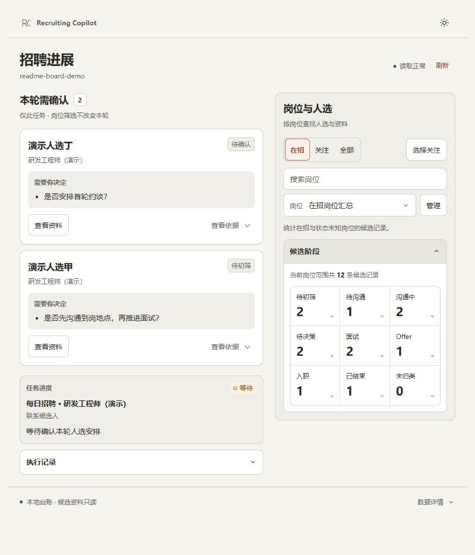
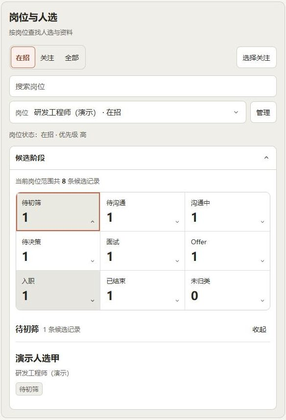
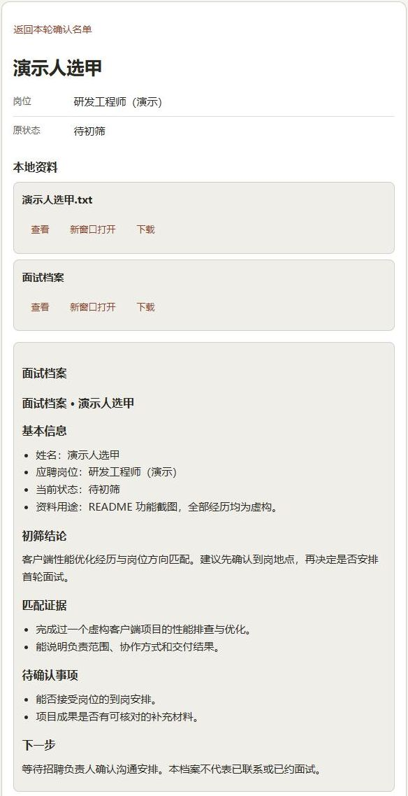

# recruiting-copilot · AI 招聘副驾

给 HR 和猎头用的招聘工作流。先把岗位要求问清楚，再让 AI 按同一套标准做 BOSS 直聘与猎聘寻源、简历初筛、面试安排、台账和日报。你通过本地看板查看进度、核对人选和处理待确认事项。

支持 Claude Code、Codex、WorkBuddy、Qoder、MiniMax Code、ZCode 等能读取项目文件的 AI 工具。招聘标准、候选台账和面试档案保存在你自己的工作区，换工具也能继续使用。



*图中展开了“候选阶段”。本页所有截图均来自实际运行的看板，岗位、姓名、经历和数字全部为合成演示数据。*

当前正式版为 **v0.7.0**，已包含招聘进展看板。[开始使用](#开始使用) · [看板功能图解](#招聘进展看板) · [已有工作区升级](docs/releases/v0.7.0.md#升级已有工作区)

## 你可以这样用

在 AI 工具中打开招聘工作区，用自然语言提出任务即可。

| 你说 | AI 按流程完成 |
| --- | --- |
| “帮我初始化招聘工作区” | 检查依赖、建立目录和模板、注册 Skill 入口，再逐岗梳理要求 |
| “梳理这个岗位的招聘要求” | 一次一问，明确硬门槛、命脉技能、排除信号、目标公司与搜索词，产出对外 JD 和对内寻源笔记 |
| “处理今天的招聘” | 查双平台未处理事项、主动寻源、按标准初筛、核对联系授权、补台账、出日报并回填搜索词 |
| “盘点这个岗位的市场人才” | 调研供给、薪资和目标公司，整理候选名单与招聘建议 |
| “评估这些简历” | 评估本地文件；也可按指定时间窗从飞书邮箱收取猎聘或 BOSS 简历附件，去重后评估并落档 |
| “帮我约面试” | 核对人选、面试官与时间，经确认后创建飞书日程和视频会议，生成候选人邀约内容并同步档案 |
| “打开招聘看板” | 查看本轮需确认人选、执行记录、逐人结果、岗位阶段和本地资料 |
| “这套工具怎么用” | 按总目录选择下一步流程 |

飞书是可选项。配置 `lark-cli` 后，可生成飞书日报文档、按授权推送日报卡片、查询面试官忙闲和创建日程，也可从飞书邮箱收取简历。未配置时，日报保存在本地，简历由你提供，约面试给出手动建会清单。

## 招聘进展看板

网页版是 Claude Desktop、Codex App、WorkBuddy 的统一入口。六个执行流程在进度脚本可用时记录实际步骤，并尽早打开或复用看板。能否显示在工具右侧取决于当前宿主；普通浏览器也能使用。

### 先看本轮需要你决定的人

首页把“本轮需确认”放在最前面。每张卡片列出候选人、台账原状态和需要你决定的具体问题。展开 **查看依据** 可以核对初筛结论，再点 **查看资料** 阅读本地档案。


确认名单只对应当前选定任务，右侧切换岗位不会改变这份名单。同一个人在本轮有多条确认记录时合并展示，避免把记录条数当成人数。看完后在 AI 对话中给出决定，由原招聘流程继续执行。

### 查清任务做到哪一步、处理过哪些人

展开 **执行记录**，可以看到任务选择、最近三条流水、最后记录时间和步骤状态。默认跟随最新任务，也可固定查看历史；阅读资料或编辑岗位时，新任务不会抢走当前页面。


点 **查看处理名单**，可以逐人核对动作、结论和下一步，并按“全部 / 需确认 / 提醒”筛选。同一人不同步骤的记录保留在同一组中。

<details>
<summary>查看逐人处理名单截图</summary>


</details>

这里展示的是已经写入本地的任务记录。读取正常表示页面能取得数据，不代表 AI 进程仍在运行；旧任务未写逐人结果时显示“未记录”，不会从台账猜补历史。

### 按岗位展开候选阶段

在 **岗位与人选** 中切换“在招 / 关注 / 全部”，选择一个岗位，再展开 **候选阶段**。点阶段数字即可查看名单，点姓名进入候选资料。



“关注”是本机保存的工作区偏好，搜索框用于缩小岗位选项。已关闭岗位的历史人选仍可在“全部”中查看。阶段按台账当前状态归类，姓名加原岗位计一条候选记录，同名不同岗位分别保留。

### 在确认前打开候选资料

候选资料页保留原岗位与原状态，并提供已关联的简历、面试档案和背景评估。Markdown 和 TXT 可在页内查看，PDF 可独立打开或下载；返回名单后保留原筛选与任务。



资料仅从招聘工作区内读取。同名、打码姓名或岗位不明确时不猜配档案；需要指定关联时，使用[文件关联配置](skills/recruit-board/references/configuration.md#明确关联候选资料)。

### 管理本地岗位状态

岗位筛选旁的 **管理** 支持在招、已下架、已关闭、暂停、待核。下图是在招岗位选择“暂停”后的待保存状态。


保存只更新工作区 `CONTEXT.md` 岗位表的一格状态，并备份原文件；取消不写入。它不会在 BOSS 或猎聘发布、下架或关闭职位。候选台账和候选状态在看板内保持只读。

## 开始使用

准备 Node.js ≥ 22、本机 Chrome 或 Edge，以及可正常登录的 BOSS 直聘或猎聘招聘者账号。涉及哪个平台，就完成对应平台的登录。Windows 下的 `sh` 命令在 Git Bash 中运行。

### 1. 下载固定版本并安装依赖

```bash
git clone --branch v0.7.0 --depth 1 https://github.com/Viy1204/recruiting-copilot.git
```

进入源码目录。

```bash
cd recruiting-copilot
```

安装两个平台的 CLI。

```bash
sh skills/recruit-init/scripts/install-dependencies.sh
```

安装器默认使用 BOSS 维护包 `@viyzhu/boss-cli-fork@0.8.5` 和猎聘包 `@viyzhu/liepin-cli`。BOSS 的源码仓库是 [Viy1204/boss-cli](https://github.com/Viy1204/boss-cli)，安装后的命令仍叫 `boss`。需要自定来源时使用 `BOSS_CLI_SOURCE` 或 `LIEPIN_CLI_SOURCE`。

若只想诊断环境，给脚本加 `--check-only`，它不会安装包或修改 shell 配置。正常安装时，macOS 若缺少 npm 全局命令路径，脚本会更新当前 shell 的配置文件。

### 2. 建立你自己的招聘工作区

用 AI 工具打开下载的 `recruiting-copilot` 目录，说：

> 帮我初始化招聘工作区。

AI 会询问工作区位置，建立模板和各工具的 Skill 入口，再逐个岗位梳理真实要求。**本仓库是工具源码，岗位数据和候选资料放在新建的独立工作区。**

已有工作区先按[升级说明](docs/releases/v0.7.0.md#升级已有工作区)同步工具文件，保留原有标准、台账和档案。

### 3. 在可见窗口中完成人工登录

BOSS 使用：

```bash
boss login
```

猎聘使用：

```bash
liepin login
```

在打开的浏览器中完成扫码或平台验证。登录态有效时复用现有会话；出现登录过期后再处理，不为检查状态反复重登。

### 4. 从工作区开始日常任务

以后用 AI 工具打开**你自己的招聘工作区**，说“处理今天的招聘”。AI 按 `CONTEXT.md` 中已经确认的标准执行，记录任务进展并交付本机看板链接。

也可通过 `npx skills add Viy1204/recruiting-copilot` 为采用 Agent Skills 约定的工具安装全局技能。工作区本身已携带流程，这一步不是必需项。

### Claude Code 插件入口

需要插件命令时，在 Claude Code 终端中添加已克隆的固定版本目录。

```bash
claude plugin marketplace add "/绝对路径/recruiting-copilot"
```

安装主插件。

```bash
claude plugin install recruiting-copilot@recruiting-copilot
```

如果已配置同名 marketplace，先核对来源再按原来源更新，见[正式版安装说明](docs/releases/v0.7.0.md#固定版本安装)。重新打开会话后，可使用 `/recruiting-copilot:recruit-init`、`/recruiting-copilot:recruit-daily`、`/recruiting-copilot:resume-review` 等入口，也可以继续用自然语言。

### DeepSeek Harness 入口

在使用 Web profile 的环境中安装：

```bash
dsh plugin --profile web add git+https://github.com/Viy1204/recruiting-copilot.git#v0.7.0
```

重新打开 DSH 会话后加载招聘技能。DSH 还提供独立的 **招聘浏览器**，用于观察两个 CLI 的平台页面，默认折叠、只读。它与上面的本地招聘进展看板用途不同，日常平台动作仍走 CLI。安装、更新和该面板的说明见 [DSH 文档](dsh/README.md)。

## 手动打开看板

日常工作流会按宿主能力启动或复用看板。只想查看现有工作区时，也可在源码目录启动服务：

```bash
npm run board -- --workspace "/绝对路径/你的招聘工作区" --port 4318
```

保持服务终端运行，在另一个终端核验工作区并取得链接：

```bash
node skills/recruit-board/scripts/connect.mjs --workspace "/绝对路径/你的招聘工作区" --url http://127.0.0.1:4318
```

`status` 为 `ready` 时，打开输出中的完整 `url`。明确查看某轮任务时，给探测命令加 `--run <任务ID>`，再打开返回的 `runUrl`。保留链接中的工作区参数，避免把另一工作区的服务当成当前看板。

工作区已复制 `skills/` 后，可用 `node skills/recruit-board/scripts/server.mjs --workspace "/绝对路径/工作区" --port 4318` 启动，无额外 npm 依赖。服务只监听本机，生命周期由宿主或可见终端管理。不同工具中的打开方式、端口冲突与复用规则见[宿主接入说明](skills/recruit-board/references/hosts.md)。

<details>
<summary>可选：Claude 原生面板</summary>

支持 function hooks/Pane 的 Claude 宿主可手动使用 `/recruiting-board`，也可带招聘工作区绝对路径。原生面板使用宿主组件，保留结果概览、近期记录和候选资料入口。

从工作区 `.claude/skills/recruit-board` 自动发现与 marketplace 安装中选择一个来源，避免重复加载。如果选择同一 marketplace 的可选插件，安装命令为：

```bash
claude plugin install recruiting-board@recruiting-copilot
```

重新打开会话后，手动运行 `/recruiting-board` 打开原生面板。兼容性以实际宿主版本为准，原生验证范围见[正式版说明](docs/releases/v0.7.0.md#回退与兼容边界)。日常任务默认使用统一网页。

</details>

## 数据保存在你的工作区

```text
你的工作区/
├── CONTEXT.md            招聘标准、在招岗位与优先级
├── AGENTS.md             告诉 AI 如何选择流程和遵守工作约定
├── skills/               同一份招聘流程和看板脚本
├── .agents/skills/       Codex / Agent Skills 发现入口
├── .claude/skills/       Claude Code 发现入口
├── .qoder/skills/        Qoder 发现入口
├── 01-jd/               对外 JD，_internal/ 存放对内寻源笔记
├── 02-sourcing/         dedup-ledger.csv 候选台账与寻源记录
├── 03-interview/        候选人面试档案
├── 04-offer/
├── 05-onboarding/
├── _shared/templates/  复用模板
└── runtime/
    ├── reports/        本地日报与评估汇总
    ├── resumes/        简历附件与导入去重索引
    └── recruit-board/  独立任务记录与岗位状态备份
```

三个隐藏的 Skill 入口指向同一份 `skills/`，避免各工具读到不同版本。没有专用发现入口的工具从 `AGENTS.md` 路由。ZCode 也可以直接读取 `AGENTS.md`，需要面板入口时再从 Codex 或 Claude Code 来源导入。

## 使用边界

- 打招呼、拒绝、通知候选人、发 offer 等对外动作默认先获得你的确认。看板中的“需确认”记录不代表已经执行，岗位状态保存也不改变平台职位。
- 两个平台默认使用可见浏览器。保留默认模式，不设 `RECRUIT_BROWSER_HIDDEN=true`。遇到验证码、安全验证、账号限制或不明发送结果时停止，先人工核验，不反复刷新、重登或重发。
- 看板读取本地台账、岗位表和独立任务记录，不连接招聘网站或 CDP。资料缺失、重复冲突、未知状态与陈旧数据会明确提示。
- 飞书邮箱仅作为简历输入渠道，按指定范围只读收取，不标已读、不移动或删除、不回复或转发。风险附件不自动下载。

## 文档与相关项目

| 入口 | 内容 |
| --- | --- |
| [v0.7.0 正式版说明](docs/releases/v0.7.0.md) | 固定版本安装、已有工作区升级、回退与兼容边界 |
| [看板配置与资料关联](skills/recruit-board/references/configuration.md) | 旧状态、岗位别名、自定义文件关联和本地岗位保存规则 |
| [看板宿主接入](skills/recruit-board/references/hosts.md) | 服务探测、工作区核验、网页与原生面板入口 |
| [共享进度协议](skills/recruit-board/references/progress.md) | 六个工作流怎样记录步骤、逐人结果与待确认事项 |
| [设计思路与理念](docs/DESIGN.md) | 为什么先梳理岗位、使用本地文件、区分内外资料并保留人工确认 |
| [BOSS CLI 维护 fork](https://github.com/Viy1204/boss-cli) | `@viyzhu/boss-cli-fork` 的安装、命令和平台操作边界 |
| [猎聘 CLI](https://github.com/Viy1204/liepin-cli) | `@viyzhu/liepin-cli` 的安装、命令与参数 |

[绝活日分享资料包](https://bytedance.larkoffice.com/docx/JAbcdCacEoxAbNxEqTjcbBotnUh) · [MIT 许可证](LICENSE)
