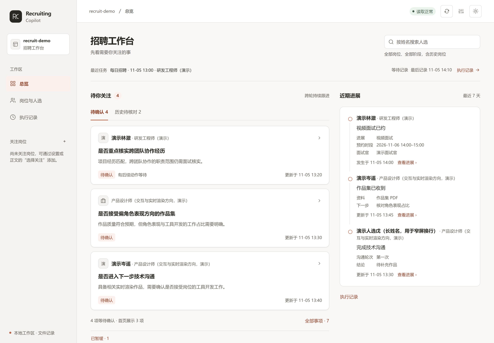
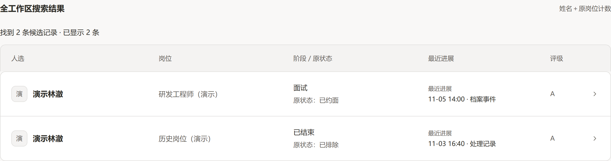
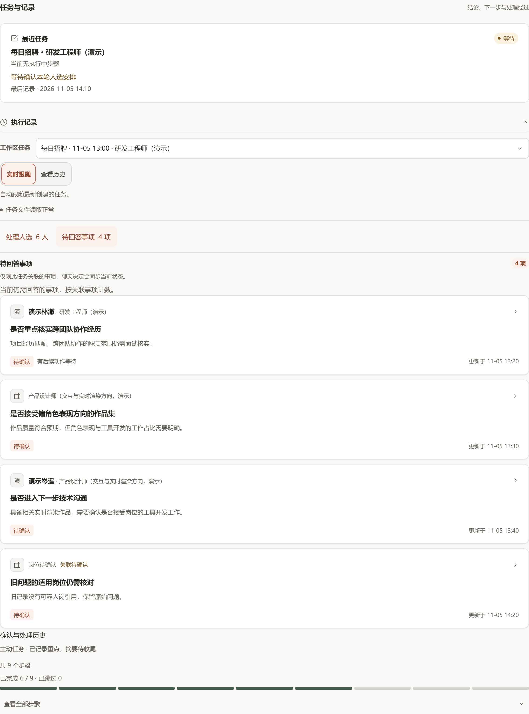
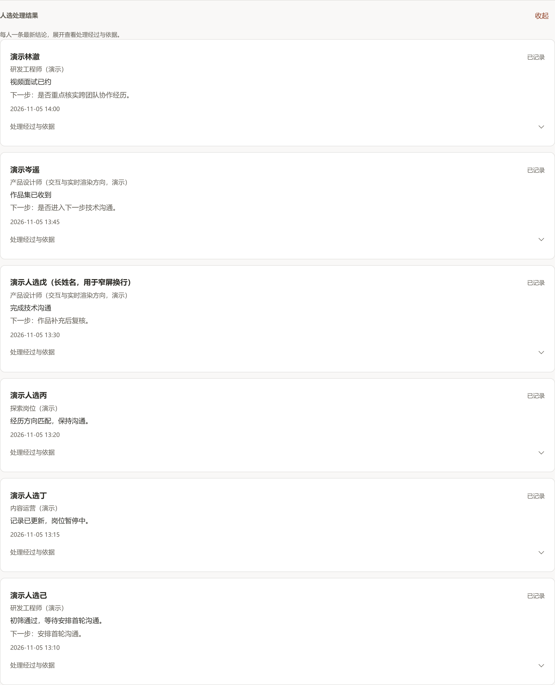
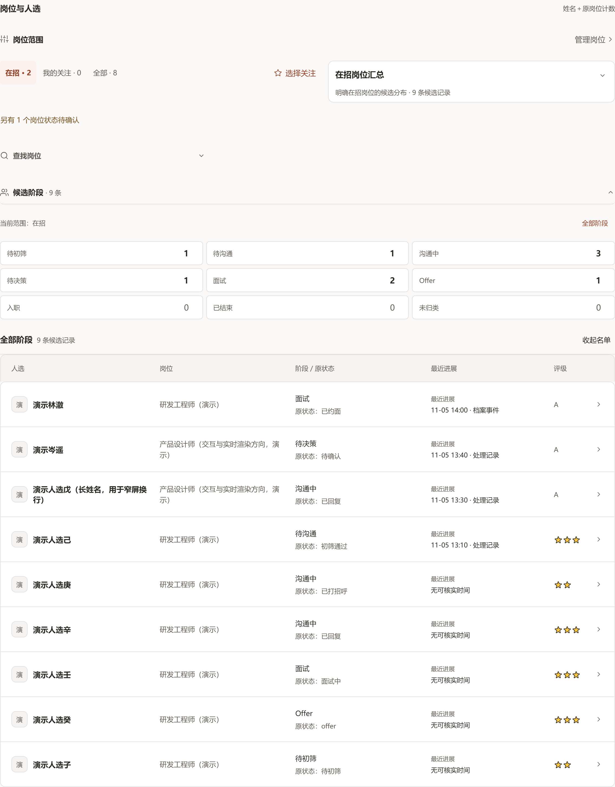
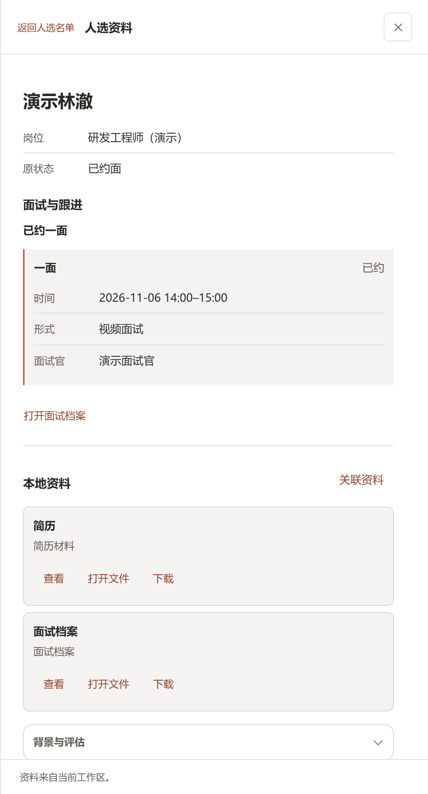
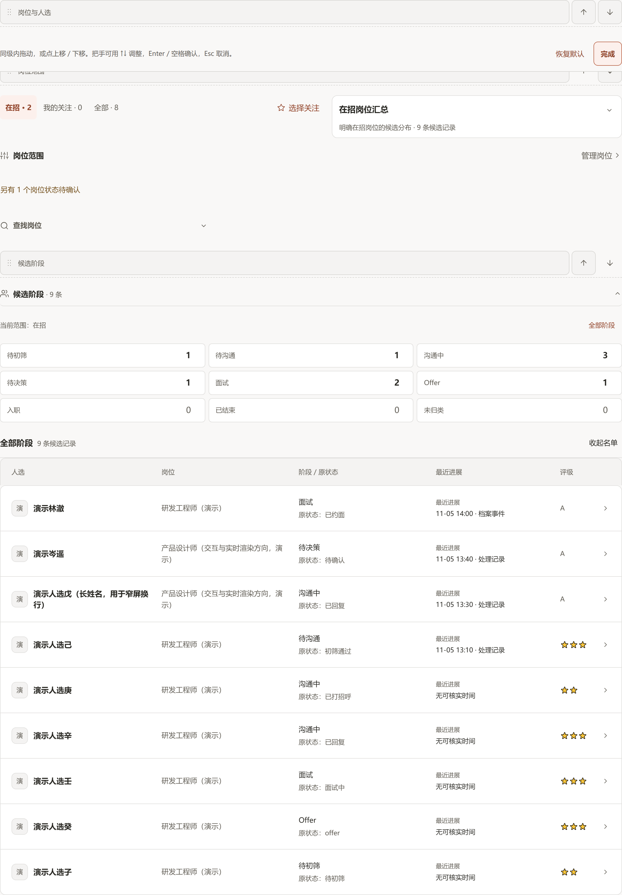
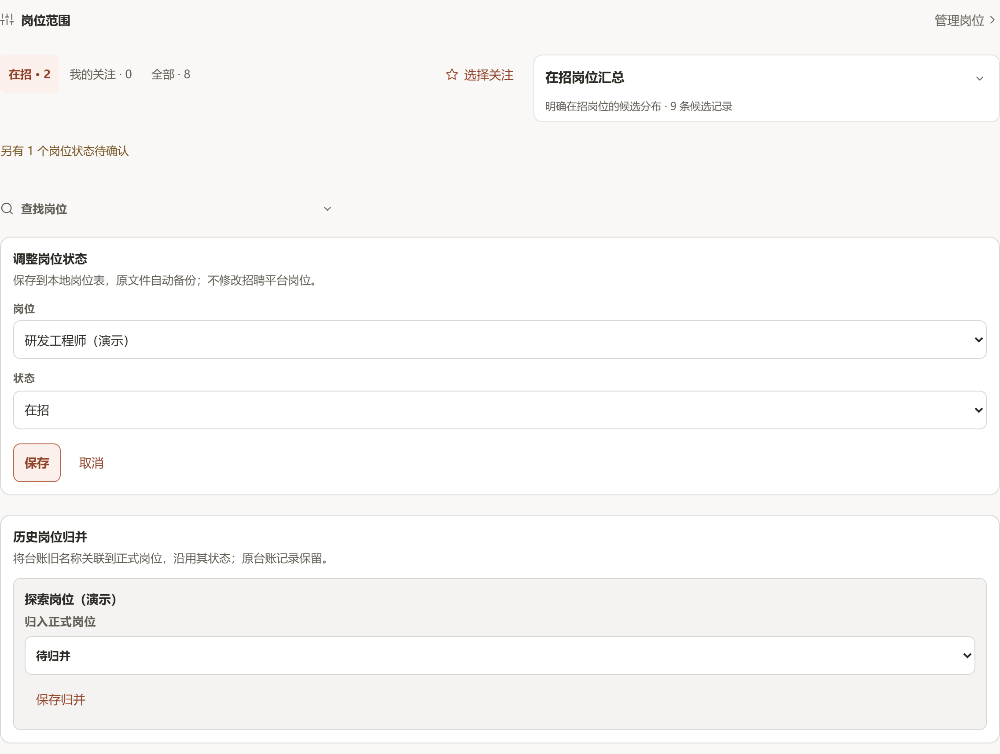

# 招聘工作台使用说明

招聘工作台用于查看招聘工作区的任务、跨轮待回答／待核对事项、近期进展、逐人处理结果和各岗位候选阶段。它伴随原招聘流程显示记录，你在 AI 对话中给出决定，再由对应流程按授权继续执行。

所有 Agent 共用同一网页，包括 Claude Desktop、Codex App、WorkBuddy。初始化、岗位梳理、每日招聘、人才盘点、简历评估和约面试这六个流程，在进度脚本可用时记录实际步骤，并尽早打开或复用看板。能否显示在工具侧栏取决于当前宿主，普通浏览器也能使用。当前源码按 [ADR 0003](adr/0003-web-only-board.md) 仅维护网页；已有原生副本的停用与升级见文末。



*截图来自当前网页的实际运行示例，岗位、姓名、经历和数字均为合成数据，点击可查看无损 PNG 原图。宽屏与窄侧栏共用同一网页，主题可在右上角切换。*

## 用导航定位工作区内容

总览、岗位与人选、执行记录是三个独立视图。宽屏从左侧 **工作区** 导航切换，窄屏使用顶部导航；同一时间呈现当前任务需要的内容。

- **总览** 显示最近任务、少量待回答／待核对摘要和近期进展。
- **岗位与人选** 提供岗位范围、姓名搜索、阶段统计和候选资料。
- **执行记录** 保留任务选择、逐人收据、历史重点与步骤状态。

**选择关注** 打开独立面板，明确是在编辑个人关注名单。面板列出全部岗位，可选择任意招聘状态，不受外层“在招”等范围限制；关注不修改岗位状态，名单按工作区保存在本机。点已关注的岗位可进入相应岗位浏览。


## 按姓名搜索工作区人选

在正文顶部的 **搜索人选** 输入完整姓名或部分姓名。搜索覆盖全部岗位、全部阶段和历史岗位，不受当前岗位筛选影响。



搜索进入 **岗位与人选** 视图，结果列出岗位与原状态；岗位名称做过映射时仍显示原岗位。点姓名打开资料，返回时恢复搜索结果。点 **清空** 恢复搜索前的岗位与阶段，切视图保留任务和阅读选择。

## 查看需要你决定的事项与近期进展

**总览** 最多显示三条当前待回答摘要；没有当前待回答但有历史待核对时，直接显示待核对摘要。每条先说明人选／对象、岗位、问题和必要背景，再提供状态及详情入口。跨轮事项不会因换任务消失，已决定但未落实的动作保留在“后续执行”。


**全部事项** 按岗位分组，保留待回答、历史待核对、已暂缓、后续执行、处理历史和全部状态筛选。岗位组显示当前列表数量，工作区总数不随岗位或任务浏览改变。默认先看已到真实期限／提醒时间或阻塞下一步的当前事项，再看其他待回答和历史待核对；同等优先级按等待时间排列，导入历史的时间不产生虚构紧急性。

**近期进展** 默认显示最近七天最多三条，更多进展有完整列表入口，更早记录从执行记录查看。人选或对象与进展是主信息，岗位、适用的已核实细节、更新时间分层显示；面试预约可显示时段和面试官，预约时间不与记录更新时间混用。桌面两栏各自按内容定高，窄屏纵向排列；无变化巡检不覆盖先前有价值的进展。

旧事项优先从可靠的来源任务和收据恢复人岗。原岗位关闭或候选不在当前台账仍保留原对象；资料不可用会提示。缺失或有歧义时标“关联待确认”，岗位未确定的归“岗位待确认”，明确面向整个工作区的归“工作区事项”；不会从自由文本姓名猜关联或合并同名异岗。

点击事项或进展先进入详情，再按需进入关联事项、人选资料或来源记录。证据和更正历史默认收起，逐层返回恢复上一层及列表位置；关闭恢复触发位置与焦点，Esc 可退出，不叠多层弹窗。看完后仍在 AI 对话中作决定；查看、没有回复或记录为“需确认”，都不表示已授权联系或安排面试。

## 查清任务做到哪一步、处理过哪些人

进入 **执行记录**，可以看到任务选择、最近三条流水、最后记录时间和步骤状态。任务名称由“任务类型 · 创建时间 · 可靠对象”组成，时间能区分时不追加 ID；同分钟仍重名时加简短序号，完整 ID 在详情保留。默认跟随最新任务，也可固定查看历史；阅读资料或编辑岗位时，新任务不会抢走当前页面。



点 **处理人选**，可以逐人核对动作、结论和下一步。同一人不同步骤的记录保留在同一组中，需确认的人选排在前面。



这里展示的是已经写入本地的任务记录。读取正常表示页面能取得数据，不代表 AI 进程仍在运行。没有任务记录时显示“尚无任务进度记录”；旧任务未写逐人结果时显示“未记录”，不会从台账猜补历史。

## 按岗位查看候选阶段

在 **岗位与人选** 中切换“在招”“我的关注”“全部”，再选择岗位。“在招”只含明确标为在招的岗位；“全部”包含在招、暂停、已关闭、已下架、待核和未知状态；“我的关注”是个人集合，不改变招聘状态。在 **候选阶段** 点阶段数字查看名单，点姓名打开候选资料。



只想缩小岗位选项时，展开 **查找岗位** 并输入岗位关键词。这个输入框只筛选岗位列表；按姓名找人使用正文顶部的 **搜索人选**。

切换范围时，原岗位仍在新范围就保留；否则清除岗位选择，回到新范围汇总并提示，阶段和人数一起更新。已关闭岗位的历史人选仍可在“全部”中查看。阶段按台账当前状态归类，姓名加原岗位计一条候选记录，同名不同岗位分别保留。

名单、阶段、岗位筛选和姓名搜索都先按最近可核实的实际进展倒序，再每批显示 20 条。时间来自有效档案事件或处理收据，并标明来源；只有日期时按日显示。未来预约、文件修改时间、任务后续更新和任意备注日期不用于排序，已撤回误记不参与当前进展。无可靠时间排后，同时间保持稳定顺序。来源异常时保留可信旧值并提示，后续更新不会抢走正在阅读的详情。

存在未知岗位时，范围旁显示“另有 N 个岗位状态待确认”，点击进入“全部”定位相应岗位。只在台账出现的岗位会说明来源，不冒认已有可修改的配置行；已配置岗位可通过岗位管理处理。成功读取且确实全部在招时，“当前全部岗位均在招”解释为何两个范围相同；空关注会提供选择入口，读取失败与空集合分别提示。

页面会区分资料缺失、重复冲突、未知状态和陈旧数据。旧工作区需要自定义状态或岗位别名时，使用[看板配置参考](../skills/recruit-board/references/configuration.md)，不要通过改台账原值迁就展示。

## 在确认前打开候选资料

从名单、事项或进展进入候选资料时，资料保留原岗位与原状态，并提供已关联的简历、面试档案和背景评估。Markdown 和 TXT 可在页内查看，PDF 可独立打开或下载。从“进展 → 关联事项 → 人选资料”进入时可以逐层返回；回到名单仍保留姓名查询、岗位筛选、任务选择和原阅读位置。



资料仅从招聘工作区内读取。同名、打码姓名或岗位不明确时不猜配档案；需要指定关联时，使用[文件关联配置](../skills/recruit-board/references/configuration.md#明确关联候选资料)。

## 调整布局与模块顺序

页面按实际可用宽度排列当前视图。总览在桌面使用事项与进展两栏，各自按内容定高；窄侧栏纵向排列。岗位与人选、执行记录独立切换，不把全部内容同时挤成三列。顶部主题按钮可切换浅色与深色。

需要调整顺序时，使用 **调整布局**。

1. 点 **调整布局**，内容区域暂时切成单列。
2. 拖动模块把手，或点 **上移**、**下移** 按钮，在同级内调整顺序。
3. 使用键盘时，聚焦把手后按 ↑ 或 ↓ 移动。按 Enter 或空格确认，按 Esc 取消本次移动。
4. 点 **完成** 恢复响应式排列。需要重置顺序时，点 **恢复默认**。



可调整确认事项、岗位与人选、任务与记录的顺序，也可调整岗位和任务区域内的子模块。排序按工作区保存在本机，升级后继续沿用已有顺序。**搜索人选** 始终排在内容区域之前，随正文滚动；它和工作区导航都不参与排序。

## 管理本地岗位状态

在 **岗位范围** 中点 **管理岗位**，选择岗位与目标状态。支持在招、已下架、已关闭、暂停、待核，保存前可核对或取消。



保存只更新工作区 `CONTEXT.md` 岗位表的一格状态，并备份原文件；取消不写入。它不会在 BOSS 或猎聘发布、下架或关闭职位。候选台账和候选状态在看板内保持只读。

## 手动打开看板

日常工作流会按宿主能力启动或复用看板。在招聘工作区中说“打开招聘看板”，也可只查看已有记录，不创建新的招聘任务。

需要手动启动时，在源码目录运行：

```bash
npm run board -- --workspace "/绝对路径/你的招聘工作区" --port 4318
```

保持服务终端运行，在另一个终端核验工作区并取得链接：

```bash
node skills/recruit-board/scripts/connect.mjs --workspace "/绝对路径/你的招聘工作区" --url http://127.0.0.1:4318 --require workspace-overview,run-highlights
```

`status` 为 `ready` 时，打开输出中的完整 `url`。明确查看某轮任务时，给探测命令加 `--run <任务ID>`，再打开返回的 `runUrl`。保留链接中的工作区参数，避免把另一工作区的服务当成当前看板。

如果招聘工作区已复制 `skills/`，在该工作区运行：

```bash
node skills/recruit-board/scripts/server.mjs --workspace "/绝对路径/你的招聘工作区" --port 4318
```

同样用该工作区的 `connect.mjs` 核验后打开返回链接。服务需要 Node.js ≥ 22，无额外 npm 依赖，只监听本机，生命周期由宿主或可见终端管理。

不同工具中的打开方式、端口冲突与复用规则见[宿主接入说明](../skills/recruit-board/references/hosts.md)。没有可用的宿主打开工具时，流程会给出本机链接，不保证自动停靠在侧栏或后台常驻。

## 原生入口退役与升级

当前源码只维护网页，保留主 `recruiting-copilot` 插件和网页 `recruit-board` Skill。独立 `recruiting-board` 插件、`/recruiting-board` 原生注册、宿主专用测试与预览同步已移除。此前的方案、ADR 和发行说明保留历史结论，后续替代关系见 [ADR 0003](adr/0003-web-only-board.md)。

已安装的旧插件、工作区副本或开发预览不会因源码删除自动停用。先用插件列表或宿主插件管理页核对实际来源与安装范围；marketplace 独立插件可由用户按实际 scope 停用，工作区或 plugin-dir 旧副本则在备份后移出已核实的原生注册入口，开发预览在创建它的宿主中停用。不要删除整个网页 Skill、共享脚本或业务记录，也不要覆盖插件缓存。

具体命令与按来源操作步骤见[原生入口退役与升级指引](../skills/recruit-board/references/hosts.md#原生入口退役与升级)。停用后按原渠道更新主插件或网页 Skill，重开会话并用 connect 核验统一网页；旧数据仍可读取。本次源码维护没有卸载任何已安装副本，也没有升级真实工作区。

## 数据与授权边界

看板读取本地台账、岗位表和独立任务记录，不连接招聘网站或 CDP。候选资料按需读取，候选台账保持只读；只有你在岗位管理中保存状态时，才更新本地岗位表并备份。

查看进度不会增加联系授权。“需确认”事项由你在 AI 对话中决定，打招呼、拒绝、通知候选人和创建面试日程仍遵守各自流程的确认规则。

旧工作区缺少进度脚本或看板接入失败时，流程说明原因后继续招聘工作，不为接入看板覆盖已有 Skill。升级工具文件时保留原有招聘标准、台账与档案，步骤见[已有工作区升级](releases/v0.8.2.md#升级已有工作区)。

## 配置与接入参考

| 文档 | 内容 |
| --- | --- |
| [看板配置与资料关联](../skills/recruit-board/references/configuration.md) | 旧状态、岗位别名、自定义文件关联和本地岗位保存规则 |
| [看板宿主接入](../skills/recruit-board/references/hosts.md) | 服务探测、工作区核验、统一网页入口与旧原生停用步骤 |
| [共享进度协议](../skills/recruit-board/references/progress.md) | 六个工作流怎样记录步骤、逐人结果与待确认事项 |
| [v0.8.2 正式版说明](releases/v0.8.2.md) | 固定版本安装、已有工作区升级、回退与兼容边界 |

[返回招聘工作流与使用入口](../README.md)
