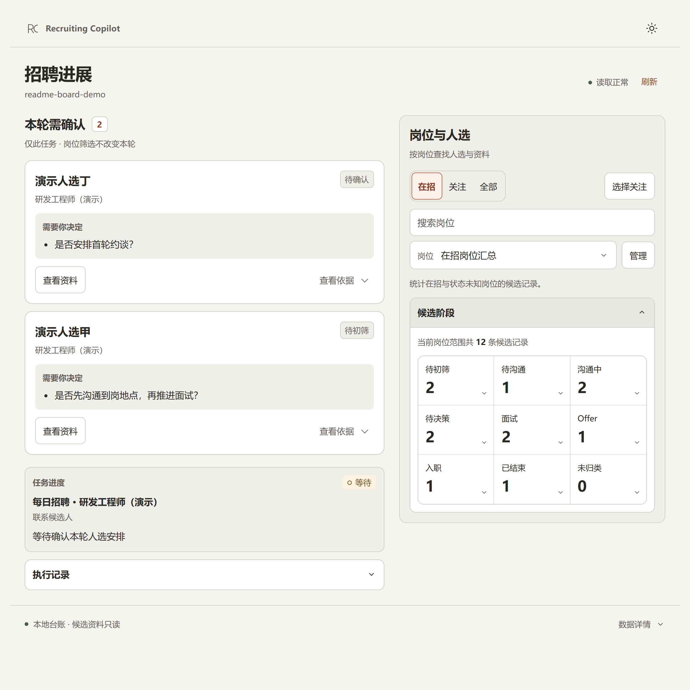
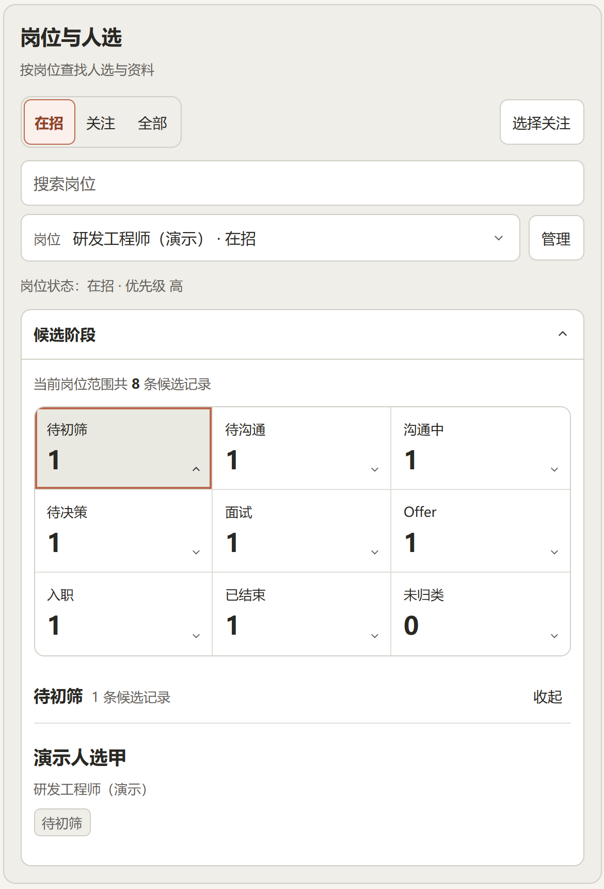
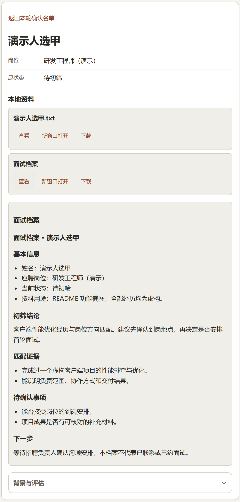
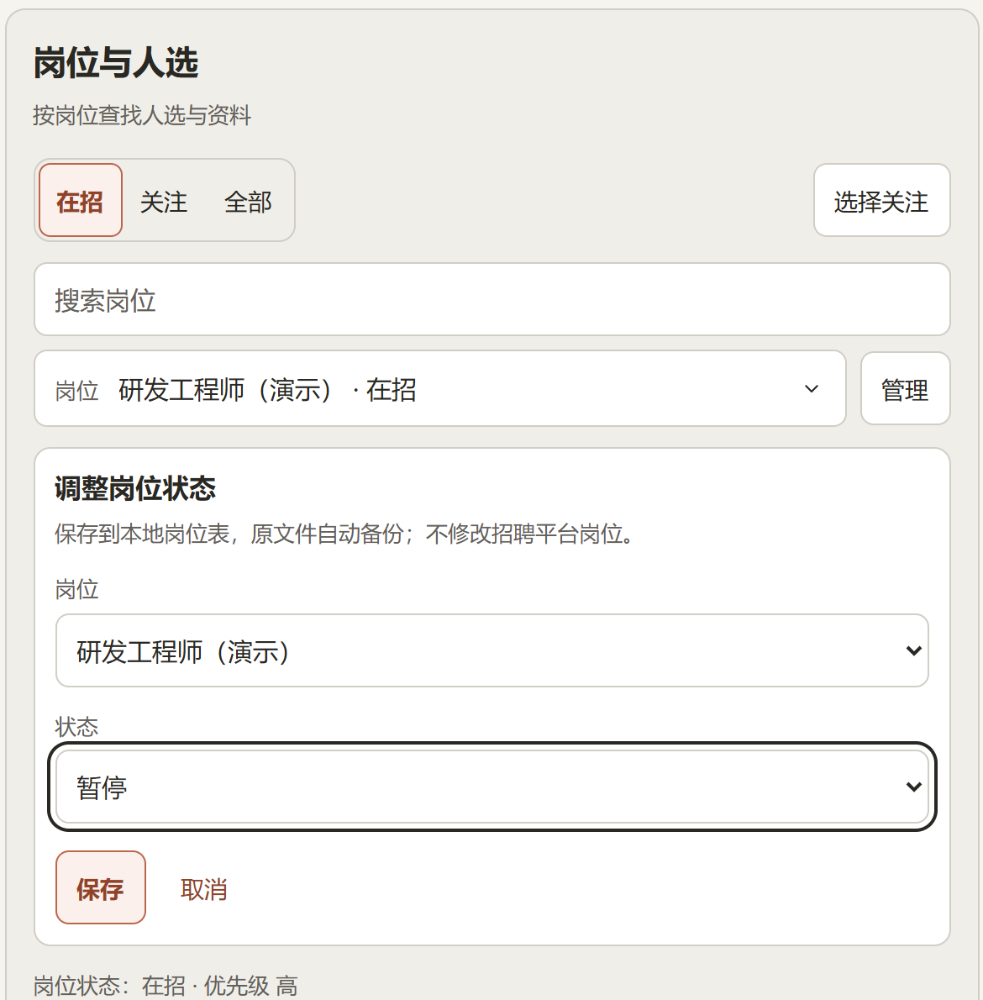

# 招聘进展看板使用说明

招聘进展看板用于查看招聘工作区的本轮任务、待确认人选、逐人处理结果和各岗位候选阶段。它伴随原招聘流程显示记录，你在 AI 对话中给出决定，再由对应流程按授权继续执行。

Claude Desktop、Codex App、WorkBuddy 默认使用同一网页。初始化、岗位梳理、每日招聘、人才盘点、简历评估和约面试这六个流程，在进度脚本可用时记录实际步骤，并尽早打开或复用看板。能否显示在工具侧栏取决于当前宿主，普通浏览器也能使用。



*图中展开了“候选阶段”。本页 7 张截图均从实际运行的网页以 2× 像素密度直接导出无损 PNG，岗位、姓名、经历和数字全部为合成演示数据。点击图片可查看高清原图。*

## 先看本轮需要你决定的人

首页把“本轮需确认”放在最前面。每张卡片列出候选人、台账原状态和需要你决定的具体问题。展开 **查看依据** 可以核对初筛结论，再点 **查看资料** 阅读本地档案。


确认名单只对应当前选定任务，右侧切换岗位不会改变这份名单。同一个人在本轮有多条确认记录时合并展示，避免把记录条数当成人数。看完后在 AI 对话中给出决定，由原招聘流程继续执行。“需确认”记录本身不代表已经联系候选人或安排面试。

## 查清任务做到哪一步、处理过哪些人

展开 **执行记录**，可以看到任务选择、最近三条流水、最后记录时间和步骤状态。默认跟随最新任务，也可固定查看历史；阅读资料或编辑岗位时，新任务不会抢走当前页面。


点 **查看处理名单**，可以逐人核对动作、结论和下一步，并按“全部”“需确认”“提醒”筛选。同一人不同步骤的记录保留在同一组中。


这里展示的是已经写入本地的任务记录。读取正常表示页面能取得数据，不代表 AI 进程仍在运行。没有任务记录时显示“尚无任务进度记录”；旧任务未写逐人结果时显示“未记录”，不会从台账猜补历史。

## 按岗位展开候选阶段

在 **岗位与人选** 中切换“在招”“关注”“全部”，选择一个岗位，再展开 **候选阶段**。点阶段数字即可查看名单，点姓名进入候选资料。



“关注”是本机保存的工作区偏好，搜索框用于缩小岗位选项。已关闭岗位的历史人选仍可在“全部”中查看。阶段按台账当前状态归类，姓名加原岗位计一条候选记录，同名不同岗位分别保留。

页面会区分资料缺失、重复冲突、未知状态和陈旧数据。旧工作区需要自定义状态或岗位别名时，使用[看板配置参考](../skills/recruit-board/references/configuration.md)，不要通过改台账原值迁就展示。

## 在确认前打开候选资料

候选资料页保留原岗位与原状态，并提供已关联的简历、面试档案和背景评估。Markdown 和 TXT 可在页内查看，PDF 可独立打开或下载；返回名单后保留原筛选与任务。



资料仅从招聘工作区内读取。同名、打码姓名或岗位不明确时不猜配档案；需要指定关联时，使用[文件关联配置](../skills/recruit-board/references/configuration.md#明确关联候选资料)。

## 管理本地岗位状态

岗位筛选旁的 **管理** 支持在招、已下架、已关闭、暂停、待核。下图是在招岗位选择“暂停”后的待保存状态。



保存只更新工作区 `CONTEXT.md` 岗位表的一格状态，并备份原文件；取消不写入。它不会在 BOSS 或猎聘发布、下架或关闭职位。候选台账和候选状态在看板内保持只读。

## 手动打开看板

日常工作流会按宿主能力启动或复用看板。在招聘工作区中说“打开招聘看板”，也可只查看已有记录，不创建新的招聘任务。

需要手动启动时，在源码目录运行：

```bash
npm run board -- --workspace "/绝对路径/你的招聘工作区" --port 4318
```

保持服务终端运行，在另一个终端核验工作区并取得链接：

```bash
node skills/recruit-board/scripts/connect.mjs --workspace "/绝对路径/你的招聘工作区" --url http://127.0.0.1:4318
```

`status` 为 `ready` 时，打开输出中的完整 `url`。明确查看某轮任务时，给探测命令加 `--run <任务ID>`，再打开返回的 `runUrl`。保留链接中的工作区参数，避免把另一工作区的服务当成当前看板。

如果招聘工作区已复制 `skills/`，在该工作区运行：

```bash
node skills/recruit-board/scripts/server.mjs --workspace "/绝对路径/你的招聘工作区" --port 4318
```

同样用该工作区的 `connect.mjs` 核验后打开返回链接。服务需要 Node.js ≥ 22，无额外 npm 依赖，只监听本机，生命周期由宿主或可见终端管理。

不同工具中的打开方式、端口冲突与复用规则见[宿主接入说明](../skills/recruit-board/references/hosts.md)。没有可用的宿主打开工具时，流程会给出本机链接，不保证自动停靠在侧栏或后台常驻。

## 可选的 Claude 原生面板

支持 function hooks/Pane 的 Claude 宿主可手动使用 `/recruiting-board`，也可带招聘工作区绝对路径。原生面板使用宿主组件，保留结果概览、近期记录和候选资料入口。

从工作区 `.claude/skills/recruit-board` 自动发现与 marketplace 安装中选择一个来源，避免重复加载。如果已按 [README 的插件安装步骤](../README.md#claude-code-插件入口)添加同一 marketplace，可安装可选插件：

```bash
claude plugin install recruiting-board@recruiting-copilot
```

重新打开会话后，手动运行 `/recruiting-board` 打开原生面板。兼容性以实际宿主版本为准，原生验证范围见[正式版说明](releases/v0.7.0.md#回退与兼容边界)。日常任务默认使用统一网页。

## 数据与授权边界

看板读取本地台账、岗位表和独立任务记录，不连接招聘网站或 CDP。候选资料按需读取，候选台账保持只读；只有你在岗位管理中保存状态时，才更新本地岗位表并备份。

查看进度不会增加联系授权。“需确认”事项由你在 AI 对话中决定，打招呼、拒绝、通知候选人和创建面试日程仍遵守各自流程的确认规则。

旧工作区缺少进度脚本或看板接入失败时，流程说明原因后继续招聘工作，不为接入看板覆盖已有 Skill。升级工具文件时保留原有招聘标准、台账与档案，步骤见[已有工作区升级](releases/v0.7.0.md#升级已有工作区)。

## 配置与接入参考

| 文档 | 内容 |
| --- | --- |
| [看板配置与资料关联](../skills/recruit-board/references/configuration.md) | 旧状态、岗位别名、自定义文件关联和本地岗位保存规则 |
| [看板宿主接入](../skills/recruit-board/references/hosts.md) | 服务探测、工作区核验、网页与原生面板入口 |
| [共享进度协议](../skills/recruit-board/references/progress.md) | 六个工作流怎样记录步骤、逐人结果与待确认事项 |
| [v0.7.0 正式版说明](releases/v0.7.0.md) | 固定版本安装、已有工作区升级、回退与兼容边界 |

[返回招聘工作流与使用入口](../README.md)
