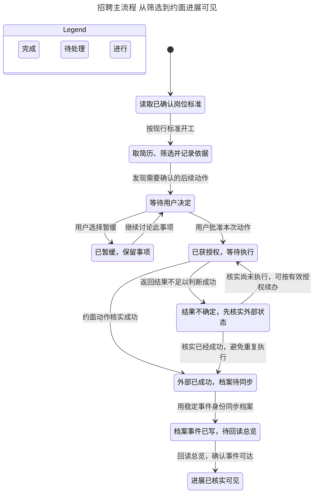
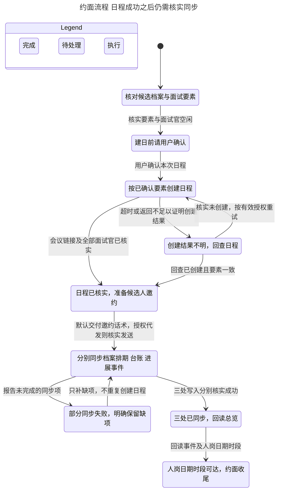

# 招聘状态机与形式化验证

这些验证用于维护 recruiting-copilot 源码，不执行招聘平台动作，也不读取真实招聘工作区。每个可执行核心子系统有一个项目级技能；另有两张跨子系统用户流程图。[浏览器熔断的异步反例](../../verification/formal/findings.md)已按用户要求修复，保留原始顺序测试和修复前证据；源码修复尚未提交。

## 技能与验证范围

| 子系统 | 技能入口 | 主要问题 | 模型与原始状态图 |
| --- | --- | --- | --- |
| 轮次与步骤 | [verify-recruit-runs](../../.claude/skills/verify-recruit-runs/SKILL.md) | 轮次什么时候能完成，结束后能否再写 | [Runs.tla](../../verification/formal/models/Runs.tla) · [Mermaid](../../verification/formal/charts/runs/chart.mmd) |
| 跨轮事项与后续动作 | [verify-recruit-decisions](../../.claude/skills/verify-recruit-decisions/SKILL.md) | 旧决定、重放与未核实动作能否破坏当前决定 | [Decisions.tla](../../verification/formal/models/Decisions.tla) · [Mermaid](../../verification/formal/charts/decisions/chart.mmd) |
| 档案进展与约面收尾 | [verify-recruit-events](../../.claude/skills/verify-recruit-events/SKILL.md) | 进展事件与约面完成条件是否一致 | [Events.tla](../../verification/formal/models/Events.tla) · [Mermaid](../../verification/formal/charts/events/chart.mmd) |
| 台账投影与最后可信快照 | [verify-recruit-snapshots](../../.claude/skills/verify-recruit-snapshots/SKILL.md) | 读取异常会不会被当作零人或新旧数据混算 | [Snapshots.tla](../../verification/formal/models/Snapshots.tla) · [Mermaid](../../verification/formal/charts/snapshots/chart.mmd) |
| 候选资料关联 | [verify-recruit-materials](../../.claude/skills/verify-recruit-materials/SKILL.md) | 资料关联能否被错误身份或旧版本覆盖 | [Materials.tla](../../verification/formal/models/Materials.tla) · [Mermaid](../../verification/formal/charts/materials/chart.mmd) |
| 岗位与别名配置 | [verify-recruit-roles](../../.claude/skills/verify-recruit-roles/SKILL.md) | 配置保存是否保留更新后的正式岗位与版本 | [Roles.tla](../../verification/formal/models/Roles.tla) · [Mermaid](../../verification/formal/charts/roles/chart.mmd) |
| 异步刷新 | [verify-recruit-live](../../.claude/skills/verify-recruit-live/SKILL.md) | 暂停、失效、超时响应是否被隔离，读取是否单飞 | [Live.tla](../../verification/formal/models/Live.tla) · [Mermaid](../../verification/formal/charts/live/chart.mmd) |
| 浏览器镜像熔断 | [verify-recruit-mirror](../../.claude/skills/verify-recruit-mirror/SKILL.md) | 熔断后异步还原能否继续派发新写入，首次风险是否保留 | [Mirror.tla](../../verification/formal/models/Mirror.tla) · [当前图](../../verification/formal/charts/mirror/chart.mmd) · [历史对照](../../verification/formal/history/before-mirror-fix/charts/mirror/chart.mmd) |

技能位于本仓库 `.claude/skills/`，服务于源码维护，不加入招聘工作区的业务技能注册清单。

## 一条命令复跑

从仓库根执行全部八个子系统：

```bash
node scripts/verify-state-machines.mjs
```

验证这些检查确实能发现错误，在临时源码副本中移除真实保护条件，再检查原始实现：

```bash
node scripts/verify-state-machines.mjs --mutations
```

只检查一个子系统：

```bash
node scripts/verify-state-machines.mjs decisions --mutations
```

普通改动只运行相关子系统；维护模型、合同、执行入口或突变时，直接使用 `--mutations`，它已经包含原始基线、TLC、全部选中变体及恢复后的基线，不必先重复运行不带参数的命令。

入口依次运行真实实现检查和 TLA+ 的 TLC 模型检查，并保留完整输出到本机临时目录。退出码非零表示实现检查、模型、覆盖记录或突变自检存在问题；只有对应断言失败才算突变被发现，导入或语法错误不算。基线失败或源码摘要漂移时不继续做突变自检，先核对失败原因。

统一入口固定验证当前仓库源码，只有内部突变运行使用隔离副本；不会沿用调用环境残留的 `FORMAL_SOURCE_ROOT`。单独运行 `*.test.mjs` 时仍可用该变量指定诊断副本。入口清理继承的 `NODE_TEST_CONTEXT`，并固定 TAP 输出；只有实际执行了测试且全部通过、没有跳过或取消，才报告 implementation PASS。`summary.json` 包含实际测试计数与源码漂移状态，恢复后的测试输出保留为 `<子系统>-restored-implementation.out`。

修改共享入口后另运行其环境隔离回归：

```bash
node --test verification/formal/runner.test.mjs
```

修复后全部复跑退出 0：八套模型与 24 项实现检查全部通过，19 个变体全部被对应断言发现；现有 238 项回归也全部通过。[验证记录](../../verification/formal/checks.md)与[机器可读结果](../../verification/formal/results.json)保留当前退出码和计数，修复前失败另存于 history/before-mirror-fix。十张当前图见[状态图索引](../../verification/formal/charts/index.md)。用户直接触发状态图技能后，修复后的镜像图已重新生成，60 个模型状态的全部规则通过；修复前反例另存历史目录。

使用 Node 22+、Java 11+。本次实跑为 Node 24.9.0、Temurin 25.0.5。TLC 固定到发布包 1.7.4，下载后必须匹配 SHA-256 `936a262061c914694dfd669a543be24573c45d5aa0ff20a8b96b23d01e050e88`。首次运行自动下载固定的 TLC；Java 优先使用 `JAVA` 或 PATH，其次定位已由 mise 安装的 Temurin 25。缺少 Java 时可运行：

```bash
mise install java@temurin-25
```

## 如何读结论

模型检查适合检查并发、重试和事件顺序。本项目的 JavaScript 没有由 TLC 直接验证：TLC 验证的是各文件明确给出的有限模型；真实实现检查把模型关注的保护条件绑定到公开函数，再用真实源码突变证明能抓错。通过不代表整个招聘系统已被证明正确。

每份技能写明来源函数、状态边界、假设和未覆盖部分。`verification/formal/coverage.json` 保存同步提交及子系统片段路径；各 `coverage-*.json` 保存实际文件摘要、实现检查和唯一突变锚点。同步源码基线为 `eb790519332fc30cde6157bcd029ef443f76dddc`。覆盖文件发生变化时，命令会报告 `COVERAGE DRIFT` 并以失败结束。先核对模型和代码，再更新摘要；只有核对过新提交，才前移同步提交，不能只更新摘要来获得通过。

每次均解读本轮 TLC 原始输出、invariant、无死锁及实现检查结果，可参照对应中文 view 说明状态流转；模型和视图未变时无需重复生成图。需要重绘时，由用户在输入框直接调用 `/pstack:statechart`，说明目标模型或流程。按当次加载的技能接口，在仓库外新建临时输出目录，复制模型、配置与 view 后运行；核对报告再更新图集。不固化插件版本路径或旧命令参数，不绕过仅用户可发起的调用限制。现存修复后镜像图由此前用户显式调用生成；本轮维护未重绘，历史图不作为本轮重新生成的证据。

图中的合并和隐藏不会减少模型检查范围。下面两个用户流程图分别隐藏结束自环，以及三处本地写入在“同步中”内部的先后次序；约面模型把档案排期、台账、事件分别写入，允许任意顺序及部分成功，不假设三份文件原子提交。各子系统图的隐藏步数见同目录 `report.md`。

## 主流程：从筛选到约面进展可见

这是一张**业务执行约定图**，依据每日招聘、约面技能及 ADR 0001、0005。它说明执行者应如何做；用户批准、授权仍有效、日程确已创建、总览回读结果可信，都是需要外部核实的输入，不能用本地事项 `decided` 或动作 `done` 反推。



[模型](../../verification/formal/models/RecruitingFlow.tla) · [配置](../../verification/formal/models/RecruitingFlow.cfg) · [view](../../verification/formal/models/RecruitingFlow.view.mjs) · [原始 Mermaid](../../verification/formal/charts/recruiting-flow/chart.mmd) · [报告](../../verification/formal/charts/recruiting-flow/report.md)

## 约面：日程成功之后仍需核实同步

这同样是业务执行约定图。默认将候选人邀约话术交给用户；只有获得发送授权才代发并核实。创建结果不明先回查；本地同步失败只补缺项，避免为补写档案重复建会。图不覆盖无飞书时的手动操作包、改期与取消的全部分支，也不验证日历服务本身。



[模型](../../verification/formal/models/InterviewFlow.tla) · [配置](../../verification/formal/models/InterviewFlow.cfg) · [view](../../verification/formal/models/InterviewFlow.view.mjs) · [原始 Mermaid](../../verification/formal/charts/interview-flow/chart.mmd) · [报告](../../verification/formal/charts/interview-flow/report.md)

## 不能从这些验证推出什么

- 候选阶段是 CSV 台账的读取投影；本仓库没有统一的候选推进写入器，不能声称已证明所有人选永不降级。
- 岗位可写状态没有业务转移图；模型应验证配置保存约束，不能臆造“只许从在招进入暂停”的规则。
- 本地 `authority`、`expiresAt` 或完成依据字段只存记录；模型不证明用户实际授权、授权是否仍有效、消息是否发出或日程是否真实创建。
- 浏览器镜像除入口守卫外，还检查无贴合需求还原分支的 await 边界；已修复首条返回后继续写入的反例，原始测试保留。不要求撤回已派发命令，也不代表风险态禁止所有输入。其他异步分支、HTTP 边界及实际浏览器行为不在该证明范围。
- 所有模型只检查写明的安全性质及无死锁；没有证明用户最终答复、网络最终返回或后续动作最终成功。

已有改动未重新核对时，使用 `/pstack:maintain-formal-verification-skill` 对齐模型与实现。任何当前实现反例都保留为发现，未经用户要求不修改产品代码。
