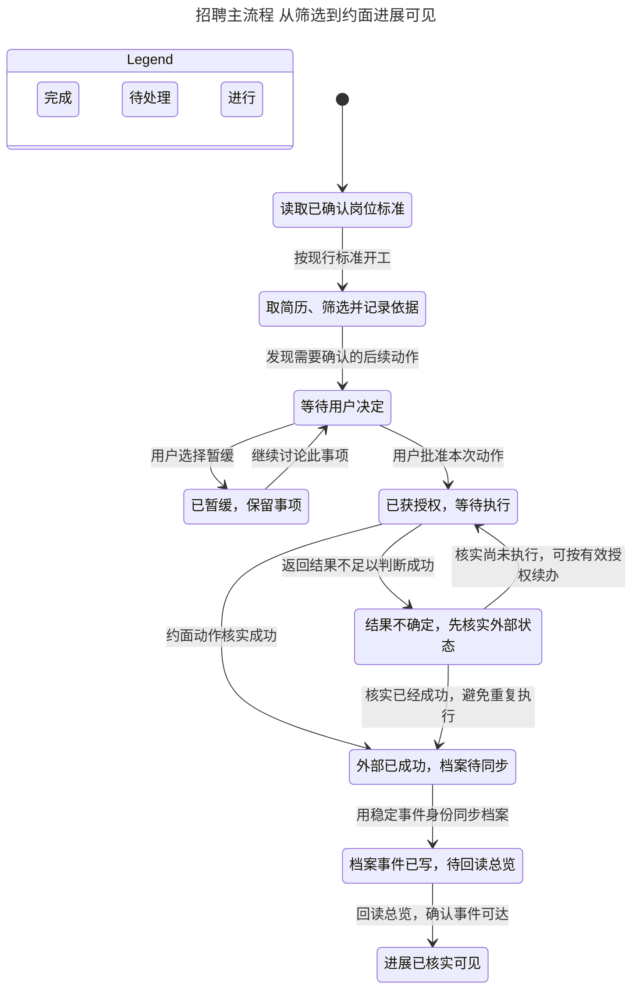
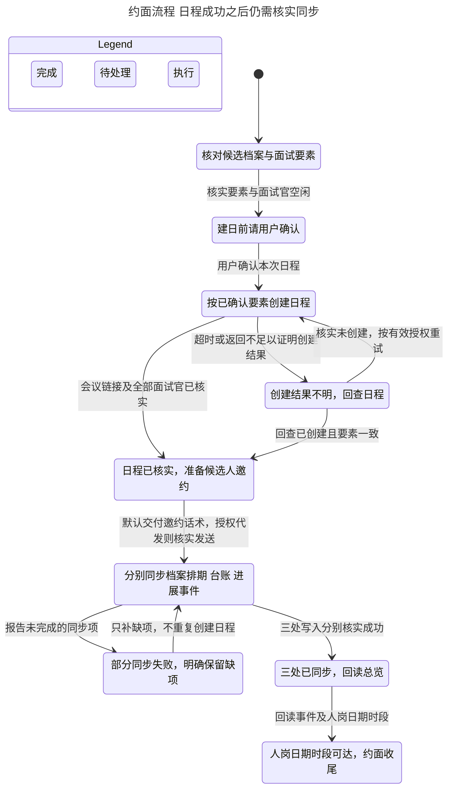
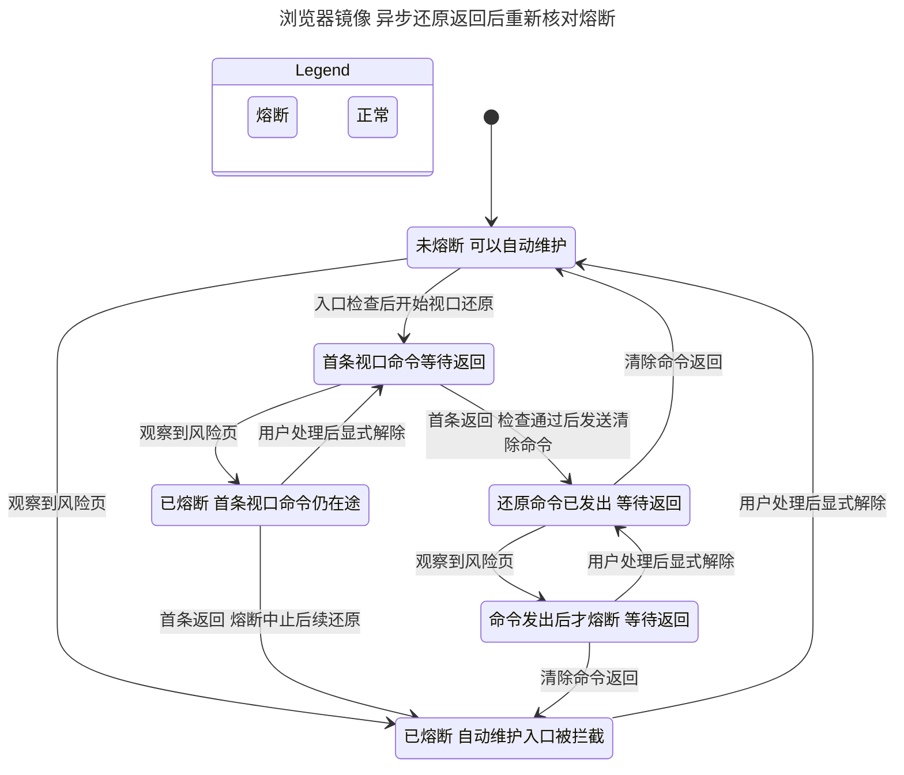
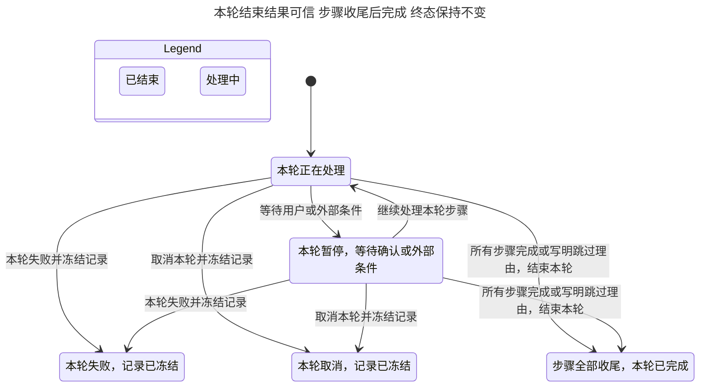
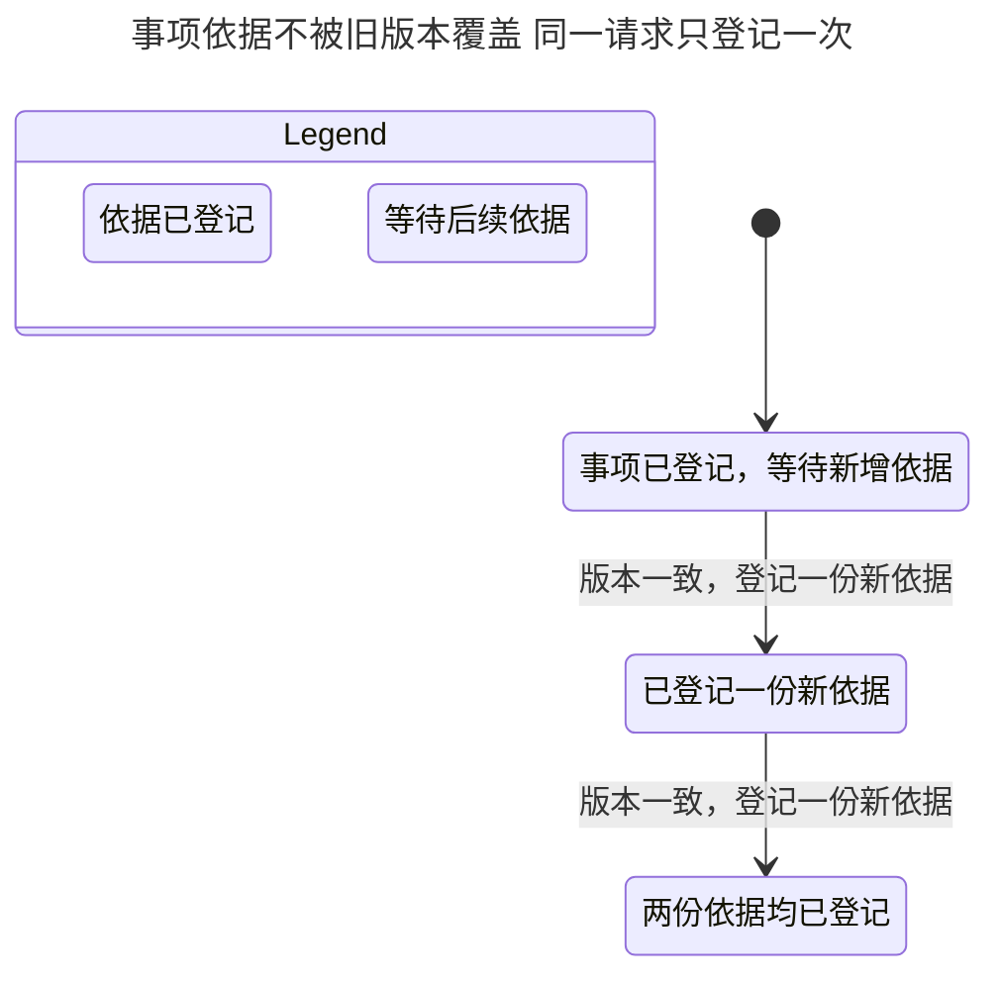
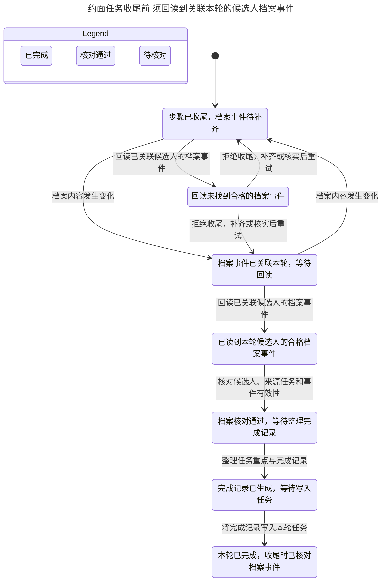
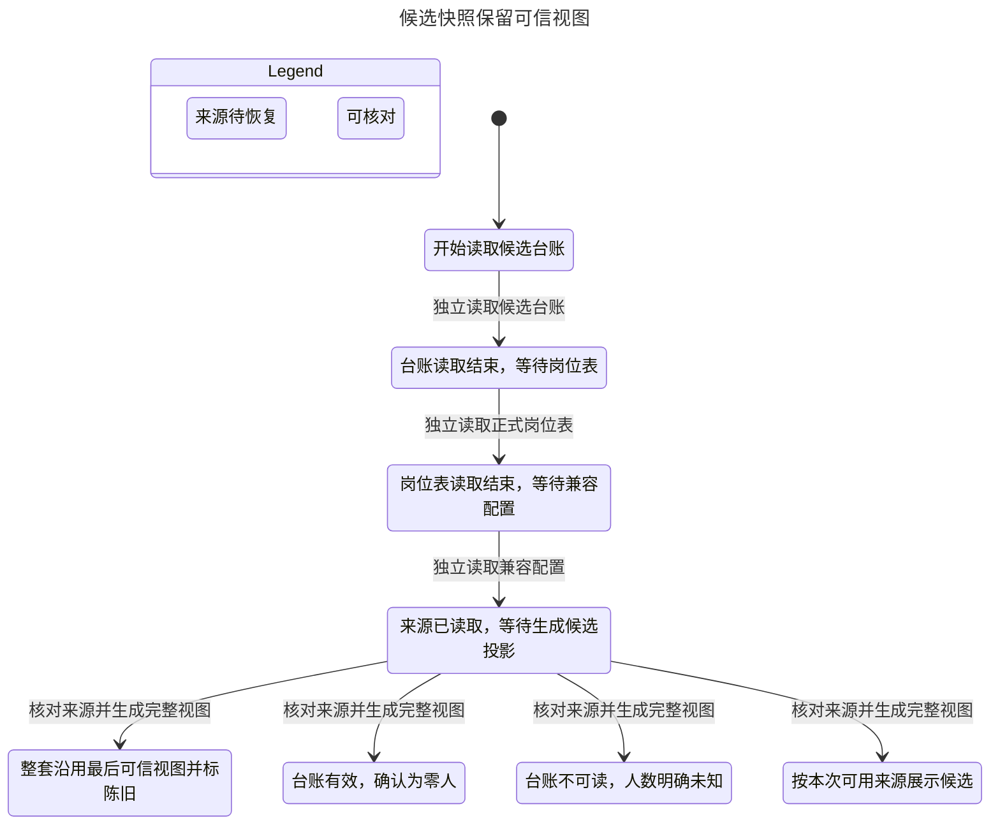
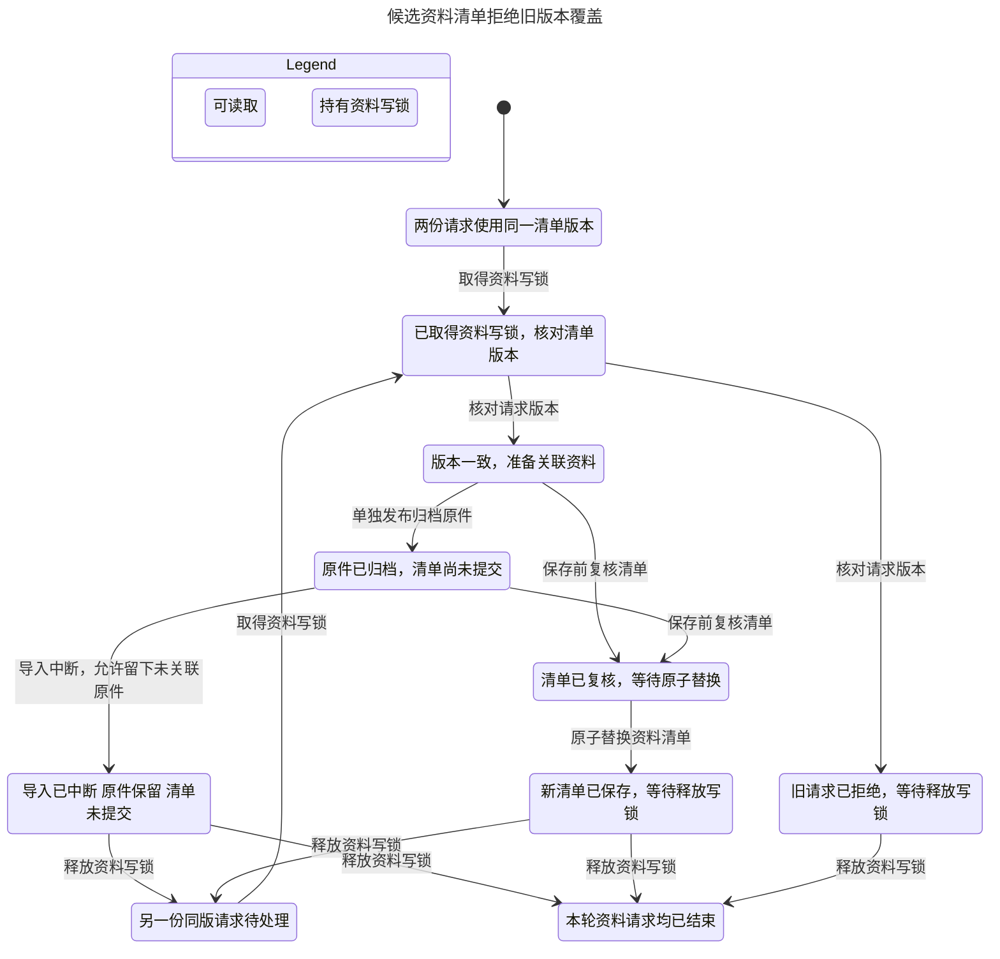
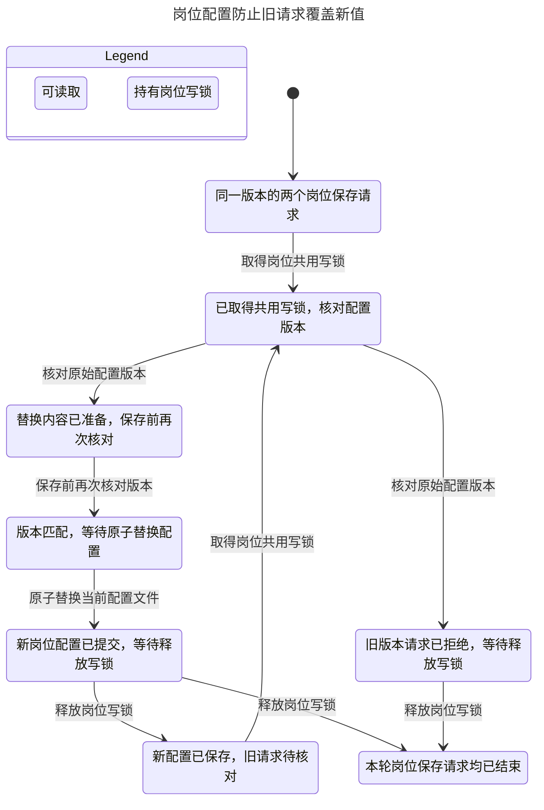
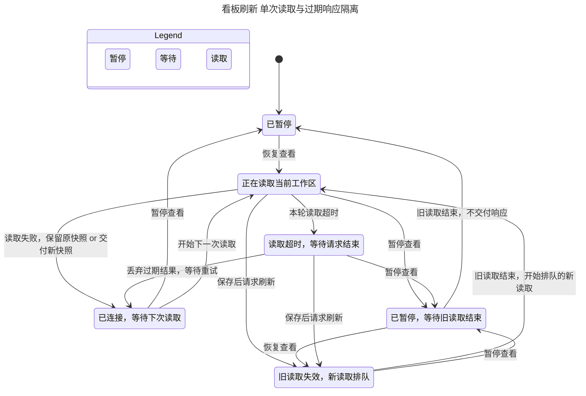

# 状态图与模型检查报告

图集包含两张业务执行约定图和八张源码子系统图，聚合不缩小模型检查范围。用户直接触发 /pstack:statechart 后，修复后的镜像图已重新生成：60个模型状态全部通过，显示为6个状态与11条箭头。修复前反例单独保留在历史目录；当前结果见 results.json，范围见各验证技能。

[验证记录](../checks.md) · [已修复反例](../findings.md) · [机器可读结果](../results.json)

## 从筛选到约面进展可见

[模型](../models/RecruitingFlow.tla) · [配置](../models/RecruitingFlow.cfg) · [view](../models/RecruitingFlow.view.mjs) · [原始 Mermaid](recruiting-flow/chart.mmd) · [完整报告](recruiting-flow/report.md)

TLC reached 9 states and 12 steps. The chart draws 9 states and 11 arrows.
The chart does not draw 1 steps that stay in one chart state.

## 约面与部分同步续办

[模型](../models/InterviewFlow.tla) · [配置](../models/InterviewFlow.cfg) · [view](../models/InterviewFlow.view.mjs) · [原始 Mermaid](interview-flow/chart.mmd) · [完整报告](interview-flow/report.md)

TLC reached 22 states and 36 steps. The chart draws 9 states and 11 arrows.
The chart does not draw 13 steps that stay in one chart state.

## 浏览器镜像 修复后熔断检查

[当前模型](../models/Mirror.tla) · [配置](../models/Mirror.cfg) · [view](../models/Mirror.view.mjs) · [当前图](mirror/chart.mmd) · [完整报告](mirror/report.md)

TLC reached 60 states and 300 steps. The chart draws 6 states and 11 arrows.
The chart does not draw 176 steps that stay in one chart state.

四项不变量与无死锁检查均通过。原来的出错路径现在在首条返回后检查到熔断，停止后续写入并等待人工解除。图合并风险来源、盯梢条件及不改变可见状态的守卫步骤；完整模型仍检查全部60个状态。

[修复前历史图](../history/before-mirror-fix/charts/mirror/chart.mmd)及[原始反例报告](../history/before-mirror-fix/charts/mirror/report.md)另行保留。

## 任务轮次与步骤收尾

[模型](../models/Runs.tla) · [配置](../models/Runs.cfg) · [view](../models/Runs.view.mjs) · [原始 Mermaid](runs/chart.mmd) · [完整报告](runs/report.md)

TLC reached 66 states and 226 steps. The chart draws 5 states and 8 arrows.
The chart does not draw 83 steps that stay in one chart state.

## 跨轮事项版本与重放

[模型](../models/Decisions.tla) · [配置](../models/Decisions.cfg) · [view](../models/Decisions.view.mjs) · [原始 Mermaid](decisions/chart.mmd) · [完整报告](decisions/report.md)

TLC reached 7 states and 22 steps. The chart draws 3 states and 2 arrows.
The chart does not draw 18 steps that stay in one chart state.

## 约面档案事件与完成条件

[模型](../models/Events.tla) · [配置](../models/Events.cfg) · [view](../models/Events.view.mjs) · [原始 Mermaid](events/chart.mmd) · [完整报告](events/report.md)

TLC reached 60 states and 420 steps. The chart draws 7 states and 9 arrows.
The chart does not draw 356 steps that stay in one chart state.

## 候选快照与来源降级

[模型](../models/Snapshots.tla) · [配置](../models/Snapshots.cfg) · [view](../models/Snapshots.view.mjs) · [原始 Mermaid](snapshots/chart.mmd) · [完整报告](snapshots/report.md)

TLC reached 195 states and 268 steps. The chart draws 8 states and 7 arrows.
The chart does not draw 76 steps that stay in one chart state.

## 候选资料保存与导入

[模型](../models/Materials.tla) · [配置](../models/Materials.cfg) · [view](../models/Materials.view.mjs) · [原始 Mermaid](materials/chart.mmd) · [完整报告](materials/report.md)

TLC reached 38 states and 51 steps. The chart draws 10 states and 14 arrows.
The chart does not draw 16 steps that stay in one chart state.

## 岗位配置版本保护

[模型](../models/Roles.tla) · [配置](../models/Roles.cfg) · [view](../models/Roles.view.mjs) · [原始 Mermaid](roles/chart.mmd) · [完整报告](roles/report.md)

TLC reached 54 states and 72 steps. The chart draws 8 states and 9 arrows.
The chart does not draw 24 steps that stay in one chart state.

## 刷新单飞与过期响应

[模型](../models/Live.tla) · [配置](../models/Live.cfg) · [view](../models/Live.view.mjs) · [原始 Mermaid](live/chart.mmd) · [完整报告](live/report.md)

TLC reached 10 states and 29 steps. The chart draws 6 states and 14 arrows.
The chart does not draw 2 steps that stay in one chart state.

